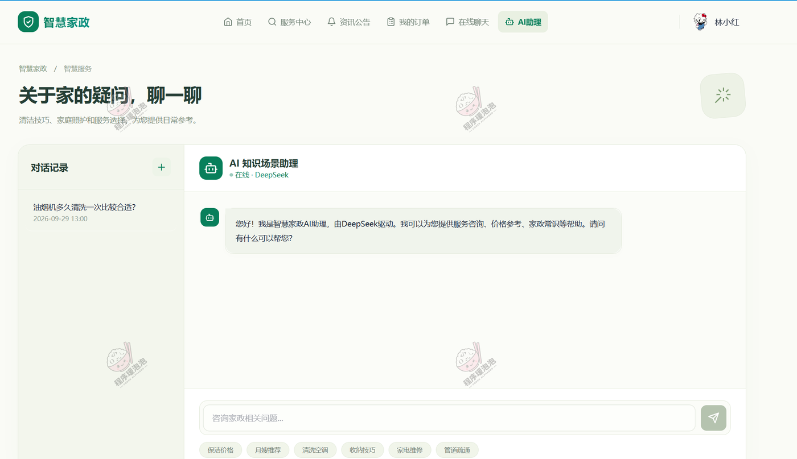
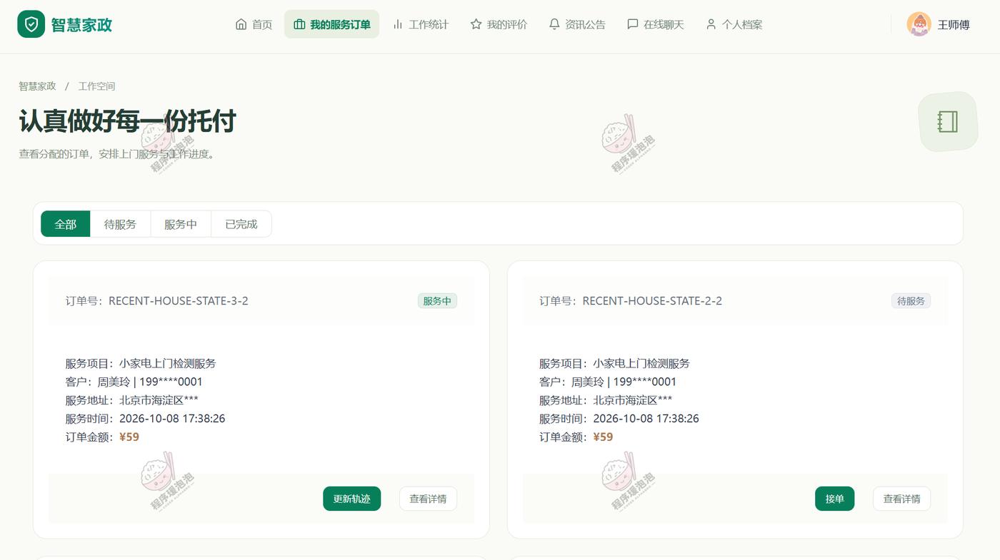
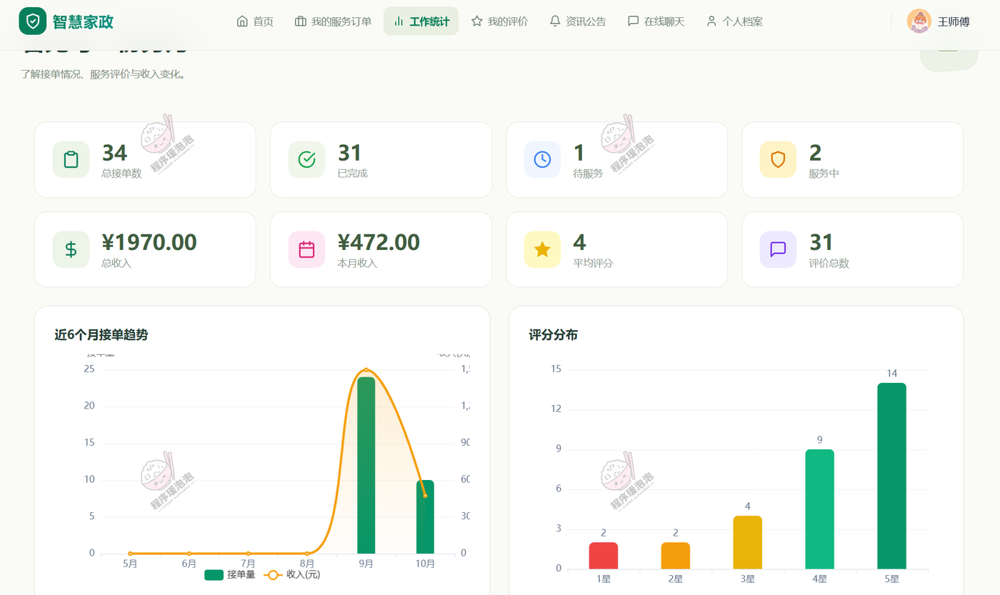
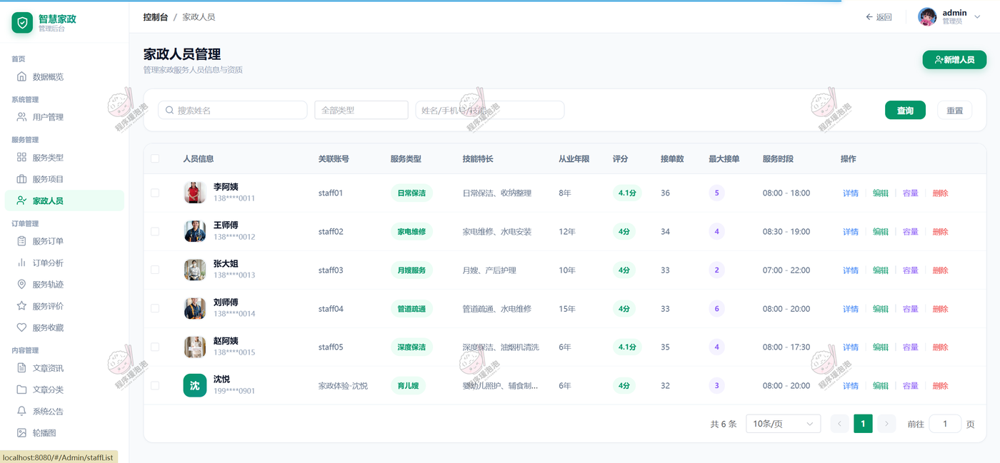
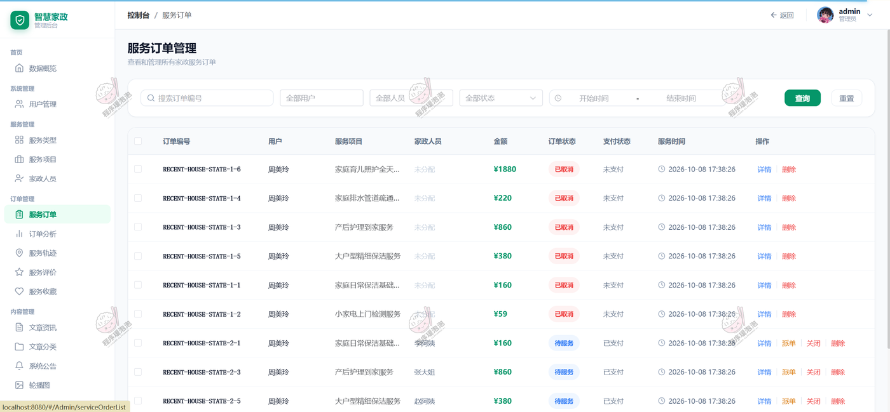
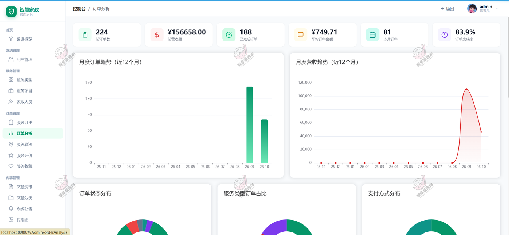

# IntelligentHomeManagement
智慧家政管理系统
亮点：AI问答、 WebSocket实时沟通、ECharts运营分析、订单规则与服务追踪；
角色：用户、家政人员、管理员；

所有源码均本人开发，项目是前后端分离的，所有的项目都具备了完整的业务逻辑，不仅仅局限于基础的增删改查（CRUD）操作，系统亮点众多。

本文注重于计算机毕业设计选题指导，列出题目均有源码， 大家可以去【公众号】(毕业终点站)获取或者加我【qq】(2112698948)提意见(别忘记Star哟)。备注：git

声明：仅用于学习使用，请勿用于任何商业行为！

1.系统非商用，非开源，非无偿。

2.由本人开发，如需源码，请联系以下方式，qq:2112698948。

3.项目有很多，并未全部上传，如果未找到想要的，可直接咨询。

# 智慧家政管理系统

> 基于 Spring Boot 3 + Vue 3 的前后端分离家政服务平台，管理员 / 家政人员 / 用户（雇主）三角色协同。
> 集成 DeepSeek AI 问答、WebSocket 实时沟通、ECharts 运营分析、家政服务业务闭环与订单规则服务追踪。

## 一、项目简介

这是一套连接雇主与家政人员的 Web 平台。雇主浏览服务、预约下单、和家政人员在线沟通、查看服务进度并评价；家政人员接单、更新服务轨迹、查看工作统计和收入；管理员维护服务项目与人员、管理订单、查看运营数据——三方围绕上门服务这条主线协作。

系统里几个花心思的地方：

- **AI 问答**：围绕服务选择、清洁技巧和家政常识提供咨询，支持流式回复与历史对话查看；文章编辑器还能通过后端调用 AI 处理文本。
- **WebSocket 实时沟通**：雇主与家政人员在线交流服务需求和上门安排，支持会话列表、消息记录及未读提示。
- **ECharts 运营分析**：订单趋势、收入统计、服务类型占比、人员排行与评价词云帮助管理员了解运营情况；家政人员也能查看个人工作统计。
- **家政服务业务闭环**：服务浏览 → 预约下单 → 模拟支付 → 人员派单 → 进度跟踪 → 完成登记 → 服务评价，完整展示雇主与家政人员的协作流程。
- **订单规则与服务追踪**：超时未支付订单自动取消、每周取消次数限制、服务轨迹展示，便于管理订单状态与履约进度。

## 二、技术栈

| 分层 | 技术 |
|---|---|
| 架构 | B/S、MVC、前后端分离，管理员 + 家政人员 + 用户（雇主）三角色 |
| 后端 | Java、Spring Boot 3、Spring MVC、MyBatis-Plus、MySQL、JWT、WebSocket、SSE、定时任务、DeepSeek |
| 前端 | Vue 3、Vite、Element Plus、Vue Router、Pinia、Axios、ECharts、AiEditor 富文本编辑器 |
| 环境 | Windows / IDEA / JDK 17 / Maven / MySQL / Node.js |

## 四、系统截图

以下选取 10 张代表性截图，按三个角色分别展示。源文档首图为登录入口页，且"首页"一节未提供截图，故未列出。

### 4.1 用户（雇主）端

**服务中心** —— 按日常保洁、深度保洁、月嫂服务、育儿嫂、家电维修、管道疏通等分类搜索服务，展示服务卡片与简介，是预约下单的入口。

**我的订单** —— 按待支付 / 待服务 / 服务中 / 已完成分类，订单卡片展示服务项目、订单号、预约时间、服务人员和实付金额，对应订单规则与服务状态管理。

**在线聊天** —— 左侧消息列表，右侧与家政人员的聊天窗口，围绕上门时间和清洁细节沟通，是 WebSocket 实时沟通的落点。

**AI 助理** —— AI 知识场景助理由 DeepSeek 驱动，提供服务咨询、价格参考和家政常识问答，左侧保留历史对话记录。

### 4.2 家政人员端

**我的服务订单** —— 按待服务 / 服务中 / 已完成分类，订单卡片展示服务项目、客户、服务地址、时间和金额，支持接单与更新轨迹，是派单和服务追踪的核心。

**工作统计** —— 总接单数、已完成、待服务、服务中、总收入、本月收入、平均评分和评价数概览，配合近 6 个月接单趋势与评分分布图。

**我的评价** —— 展示综合评分与客户评价列表，评价关联到具体服务订单，帮助家政人员了解反馈、持续改进服务。

### 4.3 管理员端

**家政人员管理** —— 维护人员的关联账号、服务类型、技能特长、从业年限、评分、接单量和服务时段，支持新增、编辑、查看与删除。

**服务订单管理** —— 按订单编号、用户、家政人员和时间筛选订单，查看金额、订单状态与支付状态，支持详情、退单和关闭。

**订单分析** —— 总订单数、总营收、已完成订单、平均订单金额、本月订单和完成率概览，配合月度订单与营收趋势、订单状态分布、服务类型占比和支付方式分布。

---

文档展示 10 张截图，需要了解更多，请联系我。
